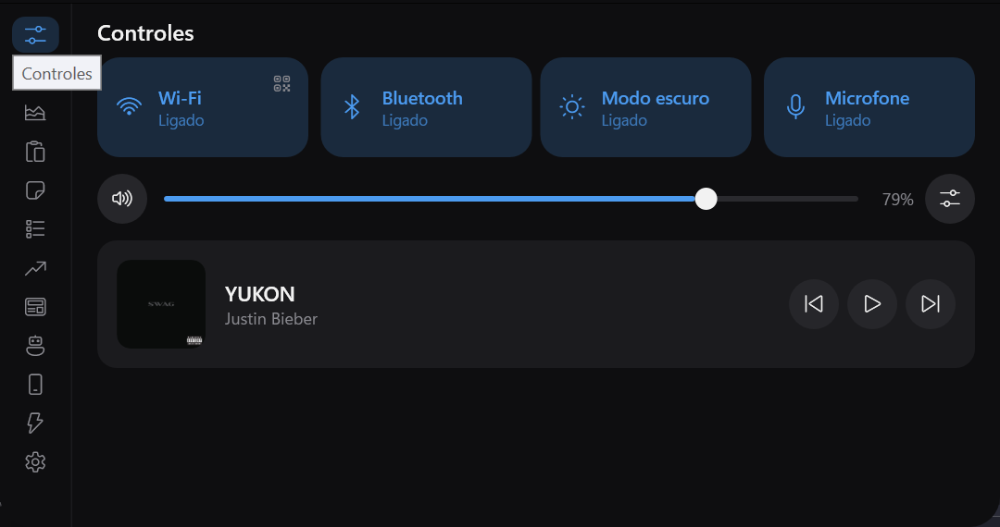
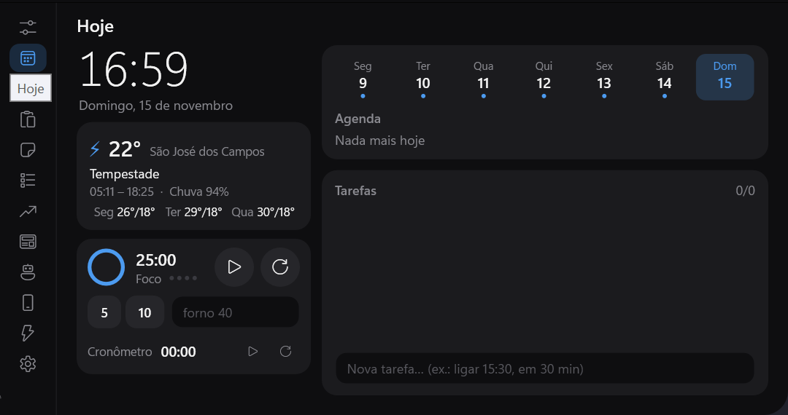
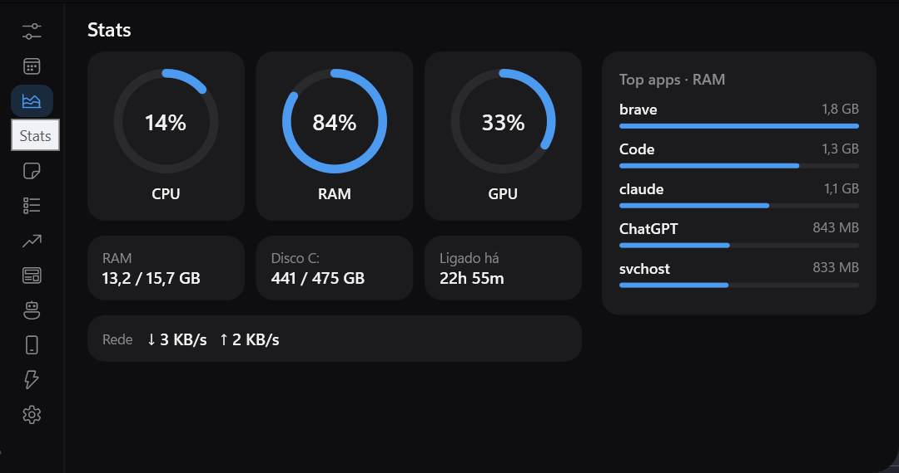
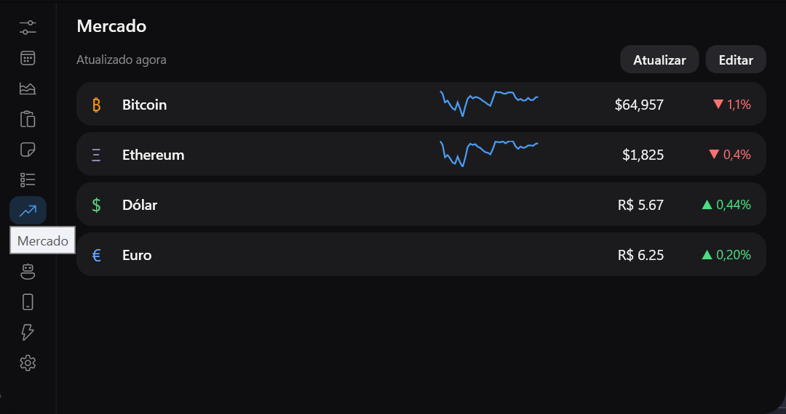
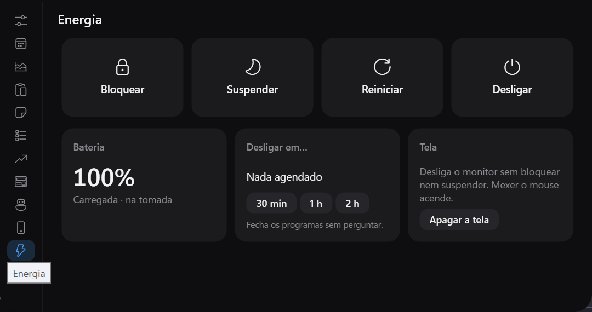
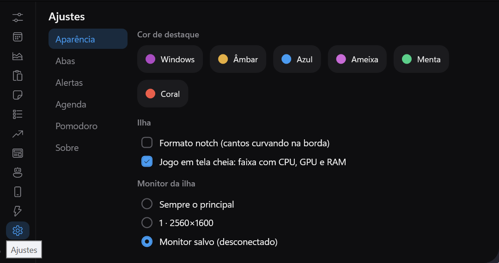

# Orbit 2.0

**Uma Dynamic Island para o Windows.** Uma pílula discreta no topo da tela que, ao passar o mouse,
vira um painel com agenda, tarefas, controles, stats, clipboard, apps, mercado, notícias, o Claude Code e uma
ponte segura com iPhone e iPad.


<p align="center">
  
</p>

Inspirado no [Hitodama](https://hitodama.in). Em repouso é uma pílula preta pequena que não chama atenção;
quando algo acontece (reunião chegando, timer correndo, câmera ligada, o Claude Code esperando resposta) ela
mostra a atividade. Passou o mouse, expande num painel com as abas num trilho de ícones à esquerda.
Some sozinha em vídeos em tela cheia e, em jogos, vira uma faixa fina com CPU, GPU e RAM.

## Telas

| Hoje | Stats |
|---|---|
|  |  |
| **Mercado** | **Energia** |
|  |  |
| **Ajustes** | |
|  | |

## O que faz

**No painel**
- **Hoje**: relógio, clima, semana com a agenda do dia e tarefas.
  - **Agenda** por link iCal (Google, Outlook/Teams): aviso 5 min antes, contagem na pílula e botão **Entrar**
    em reuniões do Teams, Meet e Zoom.
  - **Tarefas com lembrete**: escreva o horário no fim (`ligar pro cliente 15:30`, `amanhã 9h`, `em 30 min`).
    Na hora chega um alerta com **Feito** e **+10 min**; tarefas com horário entram na agenda do dia e as
    vencidas ficam em laranja no topo.
  - **Foco**: Pomodoro, vários timers ao mesmo tempo (`forno 40`, `chá 3`) e cronômetro.
- **Controles**: Wi-Fi, Bluetooth, modo escuro, volume geral e por app, mídia tocando (SMTC) com capa,
  mudo global do microfone (`Ctrl+Alt+M`).
- **Stats**: CPU, RAM, GPU, disco, rede e os apps que mais usam memória.
- **Clipboard**: histórico de texto e imagem, cifrado com DPAPI; ignora o que gerenciadores de senha marcam como privado.
- **Notas**, **Apps** (busca no menu Iniciar), **Mercado** (cripto e câmbio), **Notícias**.
- **Claude**: sessões do Claude Code via hooks; a pílula avisa quando uma está esperando você, dá pra
  **permitir ou negar** pedidos de permissão direto no alerta e acompanhar a cota de uso.
- **Energia**: bloquear, suspender, desligar agendado, apagar só a tela.
- **Ajustes** com menu lateral (Aparência, Abas, Alertas, Agenda, Pomodoro, Sobre): cor de destaque do Windows
  ou paleta própria, formato notch, monitor da ilha, abas que dá pra esconder e cada aviso liga/desliga.

**Na pílula**
- Atividade da vez, por prioridade: tela remota, câmera/microfone em uso, atualização, Claude esperando,
  reunião em até 10 min, timers e Pomodoro, mídia.
- Alertas com o ícone da aba de origem e botões quando há o que decidir (lembrete, permissão do Claude, print novo).
- Eventos do sistema: volume, saída de som, carregador, Caps Lock, internet, fone Bluetooth (com bateria) e
  **PC no limite** (RAM ou CPU acima de 90%, em laranja, com o app que mais come memória).
- Aviso de chuva chegando (Open-Meteo).
- **Conta-gotas** (`Ctrl+Alt+C`) e **desenho sobre a tela** (`Ctrl+Alt+D`).

**Ponte com iPhone e iPad (vários aparelhos)** (desligada por padrão)
- Servidor Kestrel dentro do processo, só em `127.0.0.1`, exposto ao celular pelo
  [Tailscale](https://tailscale.com) (`tailscale serve`, nunca funnel).
- PWA instalável na tela inicial: clipboard nos dois sentidos, envio de arquivos e fotos, player,
  stats, energia, abrir links.
- Câmera do PC ao vivo, microfone, **tela remota** com mouse e teclado, arquivos do PC (só leitura).
  [Transporte WebRTC e fallback compatível](docs/webrtc.md) para câmera e microfone.
- **PC → aparelho**: "Enviar para" no Explorer, arrastar pra pílula ou `Ctrl+Alt+I`.
- Notificações nos aparelhos por **Web Push** (RFC 8291/8292 com cripto nativa do .NET).

## Segurança da ponte

Expor o PC pro celular pede cuidado, então cada parte é opt-in e fechada por padrão:

- Pareamento por código de 6 dígitos (5 min, uso único, trava após 5 erros) ou QR.
- Tokens guardados só como SHA-256; revogáveis na aba Dispositivos.
- Autenticação antes do rate limit e antes de ler o corpo; auditoria em `audit.jsonl`.
- Câmera, microfone, tela, controle, teclado e arquivos são **permissões separadas por dispositivo**, todas desligadas (403), checadas também no uso do tíquete.
- Streams autenticados por tíquete de uso único; caminhos de arquivo validados contra a raiz (sem path traversal).
- Web Push só aceita endpoints de serviços de push conhecidos (anti-SSRF).

## Leve de propósito

Requisito de projeto: **CPU ~0% parado**.

- Só a aba visível do painel expandido roda timers ou faz requisições; recolhida, a ilha só escuta eventos.
- Render por software: no modo hardware o driver segurava ~165 MB nativos (medido: 260 → 95 MB).
- Avisos de fundo (lembretes, agenda, PC no limite) usam um timer só quando há algo a vigiar.
- Persistência em JSON, sem banco; poucas dependências e nenhuma DLL nativa de terceiro.

## Arquitetura

```
Orbit/
├─ Island/     janela transparente, máquina de estados (Repouso/Atividade/Alerta/Expandida/Oculta)
├─ Tabs/       uma pasta por aba: XViewModel + XView.xaml (MVVM com CommunityToolkit.Mvvm)
├─ Services/   áudio, mídia, rede, energia, clipboard, hotkeys, hooks do Claude, autoatualização
└─ Bridge/     Kestrel + PWA (HTML/JS puro), auth, Web Push, tela remota, câmera, microfone
Orbit.Tests/   harness próprio com 850+ checks, incluindo a ponte de ponta a ponta via HttpClient
```

A lógica fica em métodos estáticos puros, testáveis sem UI. O design completo está em
[`docs/superpowers/specs`](docs/superpowers/specs).

## Rodando

Requer Windows 10/11 e o [.NET 10 SDK](https://dotnet.microsoft.com/download).

```bash
dotnet run --project Orbit          # roda a ilha
dotnet run --project Orbit.Tests    # roda os testes (exit != 0 se algum falhar)
installer\build.ps1                 # instalador self-contained (precisa do Inno Setup)
```

Cada push no `master` gera uma release no GitHub (`build-<commit>`) com o zip e o instalador; o Orbit instalado
se atualiza sozinho a partir dela.

Para a ponte com iPhone ou iPad, ligue-a na aba **Dispositivos** e siga o guia de [Atalhos do iOS](docs/atalhos-ios.md).

---

Projeto pessoal, feito em português do código aos commits.
